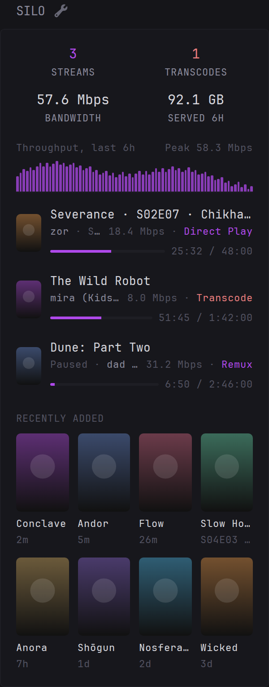
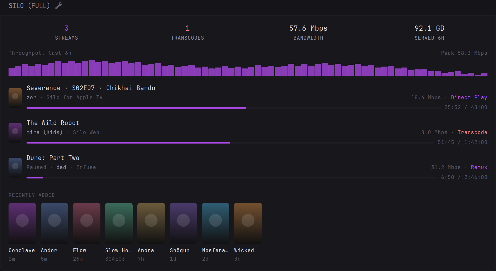

# Silo widget for Dynacat

A [Dynacat](https://github.com/Panonim/dynacat) widget for a
[Silo](https://github.com/Silo-Server/silo-server) media server: live streams,
streaming throughput and recently added titles.



- Summary: active streams, transcodes, the combined bitrate of the active
  streams, and the data served in the chart's window.
- Throughput chart: viewer egress over the last 6 hours, with the peak.
- One row per stream: title (`Series · S02E07 · Episode` for episodes), user
  and profile, client, bitrate, play method (`Direct Play`, `Direct Stream`,
  `Remux` or `Transcode`) and progress. Paused streams are marked.
- Recently added: the 8 newest movies and series, with posters and how long
  ago they arrived. Each poster links to the title in Silo.
- When nothing is playing, the widget shows "Nothing is playing" and keeps the
  summary, chart and recently added.



## Install

1. Create the API key and find the profile ID (below).
2. Set the environment variables in Dynacat's environment or `.env` file.
3. Copy [custom-api.yml](custom-api.yml) into a column's `widgets:` list in
   `dynacat.yml`.

| Variable | Description |
|----------|-------------|
| `SILO_URL` | Address Dynacat reaches Silo on, without a trailing slash, e.g. `http://silo:8080` |
| `SILO_API_KEY` | The scoped API key (starts with `sa_`) |
| `SILO_PROFILE_ID` | The profile whose libraries recently added shows |

### Create the API key

In Silo, open Admin, API Keys, and create a key with **Selected scopes**:

- `admin:monitor:read`: live sessions and the throughput history.
- `catalog:read`: the recently added list, read as one profile.

Admin scopes only work on a key owned by an admin account.

### Find the profile ID

Recently added is read as a profile, so the widget sends its ID. With the key:

```sh
curl -H "Authorization: Bearer $SILO_API_KEY" "$SILO_URL/api/v2/profiles"
```

Use the `id` of the profile whose libraries you want to show, usually the
primary one. The list follows that profile's library access and rating
limits.

## Settings

All of these are in `custom-api.yml`:

| Setting | Default | Effect |
|---------|---------|--------|
| `cache` | `30s` | How often Dynacat refreshes the widget |
| `options.public-url` | `SILO_URL` | Address the poster links open. Set it when `SILO_URL` is an internal address. |
| `subrequests.throughput.parameters.hours` | `6` | Chart window, 1 to 744 hours |
| `subrequests.recent.parameters.type` | `video` | `movie`, `series`, `episode`, or `video` for movies and series |
| `subrequests.recent.parameters.limit` | `8` | Number of recently added titles |

Silo samples throughput once a minute and returns 5 minute buckets for
windows up to 48 hours, then wider ones; each bar is the peak of its bucket.

## What it reads

| Request | Silo route | Scope |
|---------|------------|-------|
| Streams | `GET /api/v2/admin/sessions` | `admin:monitor:read` |
| Throughput | `GET /api/v2/admin/stats/timeseries?hours=6` | `admin:monitor:read` |
| Recently added | `GET /api/v2/catalog?sort=-added_at&type=video&limit=8` | `catalog:read` |

- The key cannot play media, control sessions, change settings, manage users
  or read file paths. `admin:monitor:read` returns no file paths, node
  addresses or credentials.
- Dynacat fetches the posters and serves them from its own cache, so the
  browser does not contact Silo.
- Bandwidth is the sum of each stream's measured bitrate. When Silo has no
  measurement yet, the stream's target bitrate counts, then its source
  bitrate.
- Served is the viewer egress Silo measured over the chart window. Silo calls
  it a close estimate, not byte-exact accounting.
- Silo answers a scoped key's stats reads from a shared cache up to 30
  seconds old, so a `cache` below `30s` does not make the chart fresher.

## Troubleshooting

Test each request from the Dynacat host:

```sh
curl -H "Authorization: Bearer $SILO_API_KEY" "$SILO_URL/api/v2/admin/sessions"
curl -H "Authorization: Bearer $SILO_API_KEY" "$SILO_URL/api/v2/admin/stats/timeseries?hours=6"
curl -H "Authorization: Bearer $SILO_API_KEY" -H "X-Profile-Id: $SILO_PROFILE_ID" "$SILO_URL/api/v2/catalog?sort=-added_at&limit=8&type=video"
```

- `401`: the key is wrong or revoked.
- `403 permission_denied`: the key lacks a scope, or its owner is not an
  admin.
- `422` on the catalog request: `SILO_PROFILE_ID` is missing or not a profile
  on the key's account.

A failure in any of the three requests shows as an error on the whole widget.

For Silo behind a self-signed HTTPS certificate, add `allow-insecure: true`
to the widget and to both subrequests.

## Tested

On a live server, the maintainer has run the widget on Silo's `latest` image
(2026-11-18) with Dynacat 3.0.2.

It has also been rendered by Dynacat built from source (Dynacat `main`,
2026-11-18) in a small and a full column, against a stand-in for Silo that
answers the three routes in the shapes of Silo's `/api/v2` OpenAPI contract,
including the empty state and a change of the chart window.

## License

[MIT](LICENSE)
